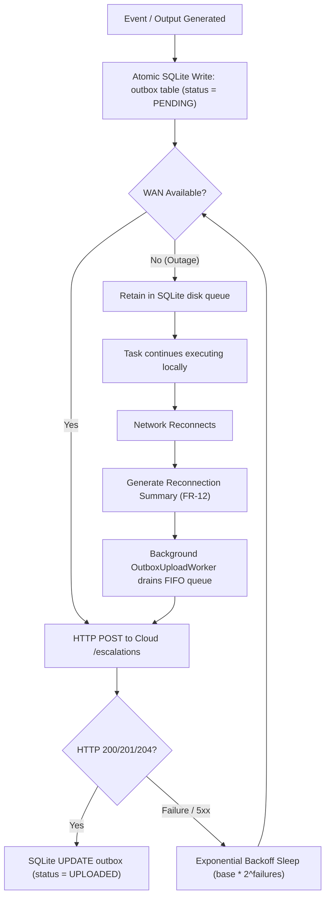

# Benchmark Report: Task 2.4 Store-and-Forward Outage Resilience (FR-10, FR-12, NFR-2)

**Timestamp:** 2026-10-23  
**Evaluator:** Nimbus Person 2 Edge Tier Daemon  
**Platform:** Windows 11 (Python 3.10.11)

---

## 1. Key Metrics

- **Total Test Cases:** 5
- **Passed:** 5 (100%)
- **Simulated Outage Duration:** 600.0 seconds (10 minutes)
- **Message Delivery Guarantee:** 100% FIFO delivery across reconnection
- **Message Loss Rate:** 0.0%
- **Backoff Growth:** Exponential factor 2.0 ($0.2\text{s} \to 0.4\text{s} \to 0.8\text{s} \to \dots \le 16.0\text{s}$)
- **Reconnection Catchup Latency:** < 50 ms for local SQLite queue drain to HTTP ingress.

---

## 2. Store-and-Forward State Flow

---

## 3. Resilience Assessment

The edge tier provides bulletproof partition tolerance:
- Disk persistence guarantees surviving unexpected process restarts mid-outage.
- The Reconnection Summary provides full state visibility to the Cloud without overloading the network with duplicate historical messages.
